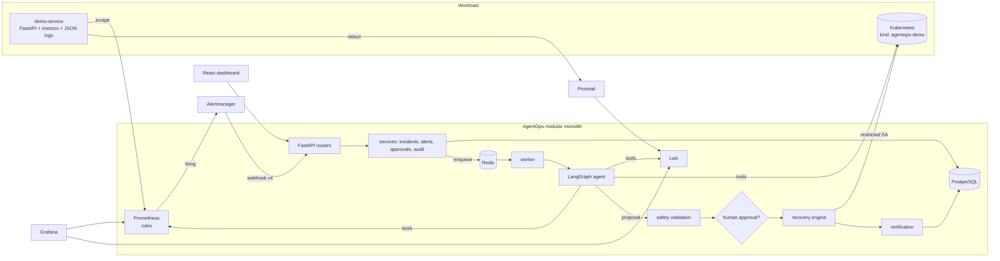

# AgentOps — AI Incident Response & Safe Rollback Platform

AgentOps receives **real alerts** from Prometheus/Alertmanager, investigates them with a
**LangGraph** agent that calls **real tools** (Prometheus, Loki, Kubernetes, PostgreSQL), proposes a
recovery action, asks a human for approval when the risk requires it, executes only predefined and
validated actions, **verifies** the result against explicit criteria, and records everything in an audit log.

It is not a chatbot. The LLM never supplies operational facts and never changes workflow state.

> **Status: Phase 1 complete in code; full-stack validation is partial.** Backend (59 tests), demo service (7)
> and frontend (13) tests pass. The Docker Compose + kind end-to-end run has **not** been executed by the author
> yet (no Docker daemon / kind on the development machine). See [Known limitations](#known-limitations) and
> [What has and has not been verified](#what-has-and-has-not-been-verified).

## Problem statement

On-call engineers lose minutes to the same loop: read the alert, check dashboards, grep logs, look at the last
deployment, decide between restart / rollback / scale, then confirm the fix worked. AgentOps automates the evidence
gathering and verification while keeping a human in the loop for anything risky, and makes every step auditable.

## Architecture



Details: [docs/ARCHITECTURE.md](docs/ARCHITECTURE.md).

## Technology stack

| Area | Tech |
| --- | --- |
| Frontend | React, TypeScript, Vite, Tailwind CSS, Recharts, React Router, Axios, Vitest + React Testing Library |
| Backend | Python 3.11, FastAPI, Pydantic v2, SQLAlchemy 2, Alembic, PostgreSQL |
| Agent | LangGraph, configurable LLM (OpenAI-compatible or Anthropic), structured output, deterministic fallback |
| Observability | Prometheus, Alertmanager, Grafana, Loki, Promtail, OpenTelemetry (OTLP) |
| Infra | Docker, Docker Compose, Kubernetes (kind), Redis |
| Tests | pytest, Vitest, an opt-in real-stack e2e test |

## Data sources — where the facts come from

| Source | What it provides | Used by |
| --- | --- | --- |
| **demo-service** | Real activity: HTTP traffic, `/metrics`, structured JSON logs, controllable faults | everything below |
| **Prometheus** | Metrics (requests, errors, latency, CPU/memory, health, version) and the **alert rules** | `get_service_metrics`, verification |
| **Alertmanager** | Routes firing alerts to `POST /api/v1/alerts/webhook` | incident creation |
| **Loki** | Structured logs (timestamp, service, level, request id, incident id, version, exception) | `get_recent_logs` |
| **Kubernetes** | Pods, restarts, image versions, deployment status and rollout history (namespace `agentops-demo` only) | `get_kubernetes_pods`, `get_deployment_status`, `get_deployment_history`, recovery |
| **PostgreSQL** | Incidents, alerts, agent executions, tool calls, proposals, approvals, recovery actions, snapshots, audit log | persistence, `get_previous_incidents` |
| **Redis** | Background investigation/execution queue, distributed locks, idempotency keys | worker |
| **LLM** | Reasons over evidence collected by tools. **Not** a source of operational facts | analysis node only |

If a source is unavailable the tool returns a **structured error**, the investigation records a *data gap*, and
nothing is fabricated. Example: with Loki down, no log evidence appears in the diagnosis; it lists
`get_recent_logs: loki unavailable ...` under "data gaps".

## Alert generation workflow

1. The failure simulator genuinely changes `demo-service` (latency, 5xx responses, readiness) or rolls a faulty
   release (`2.0.0`, `BAD_RELEASE=true`) to the Kubernetes deployment.
2. Prometheus scrapes the new behaviour; rules in [`infra/prometheus/rules/demo-service.yml`](infra/prometheus/rules/demo-service.yml)
   fire: `HighErrorRate`, `HighLatency`, `ServiceUnavailable`, `UnhealthyInstances`.
3. Alertmanager POSTs to the AgentOps webhook, which validates the payload (Pydantic), stores the alert, creates or
   attaches to the service's active incident, and queues an investigation. Webhook redelivery is idempotent
   (`fingerprint + startsAt` unique; Redis idempotency key).

The dashboard cannot create alerts or incidents; only the simulator (which changes the *service*) exists.

## AI agent workflow (LangGraph)

```
inspect_alert → collect_metrics → collect_logs → collect_kubernetes → check_health → previous_incidents → analyze → propose | finish
```

* Fixed topology in code; the LLM cannot add tools, skip steps, or change incident state.
* Tools (all persisted with input, output, status and duration; see `GET /api/v1/agent/tools`):
  `get_service_health`, `get_service_metrics`, `get_recent_logs`, `get_kubernetes_pods`, `get_deployment_status`,
  `get_deployment_history`, `get_previous_incidents`, `propose_recovery_action`. There is **no shell tool**.
* **Evidence is generated by code** from tool results (ids `E1…`). The LLM may only cite those ids.
* Output (`Diagnosis`): incident summary, observed symptoms, evidence, root cause (**confirmed** vs **hypothesis**),
  hypotheses, confidence, recommended action, risk assessment, verification criteria, data gaps.
* Without `LLM_API_KEY` (or when the LLM errors, returns bad JSON, cites missing evidence, or proposes an unsafe
  action) the **deterministic rule engine** produces the diagnosis. The incident workflow is unaffected.

## Recovery workflow

`propose → safety validation → (approval) → pre-checks + snapshot → execute → wait for rollout → verify → resolve | escalate | fail`

* Allowed actions only: `restart_pods {scope}`, `rollback_deployment {target_revision|target_version}`,
  `scale_deployment {replicas}` (bounded by `MIN_REPLICAS`/`MAX_REPLICAS`).
* Risk: rollback = high, restart = medium, scale-up = low. Risks listed in `REQUIRE_APPROVAL_FOR_RISK`
  (default `medium,high`) wait in `awaiting_approval`; low risk is auto-approved by policy (still audited).
* Rollback pre-checks: target exists in rollout history, differs from current, version known; current and target
  version/revision are recorded before acting. Parameters are re-validated right before execution.
* Verification (polled, N consecutive passes required): rollout complete, expected version, all pods ready, `/ready`
  probe, Prometheus `up`, no unhealthy instances, 5xx ratio ≤ `VERIFY_MAX_ERROR_RATE`, p95 ≤ `VERIFY_MAX_P95_LATENCY_SECONDS`.
  **Missing data fails the check.** Only a passing verification resolves the incident.
* If a restart/scale fails verification, a **rollback proposal** is created and waits for approval. If a rollback fails
  verification, the incident is marked `failed` and **automated actions stop**.

Incident states: `open → investigating → awaiting_approval → recovering → resolved | failed` (enforced in
`services/incidents.py`; invalid transitions return 409).

## Safety design

* Predefined actions + Pydantic parameter models with `extra=forbid`; no free-form commands anywhere.
* Kubernetes access via a **namespace-scoped Role** ([`k8s/40-rbac.yaml`](k8s/40-rbac.yaml)): no ClusterRole, no
  secrets, no exec, no create/delete of deployments. The backend uses a service-account token kubeconfig, never admin
  credentials; `scripts/kind-setup.*` prints `kubectl auth can-i` proofs.
* Namespace and deployment are fixed in configuration, not parameters.
* Human approval for medium/high risk; approvals/rejections recorded and shown on the timeline.
* Distributed lock: one recovery per deployment at a time. Timeouts and bounded retries on every external call.
* Fail closed: Kubernetes unreachable ⇒ proposal blocked; verification data missing ⇒ check fails.
* Audit log for alert intake, investigation, proposals, decisions, execution, verification, simulator use.
* LLM output is schema-validated, citations checked, "confirmed" claims without evidence are downgraded, and its action
  must pass the same safety validation as any other.

## Installation

Prerequisites: Docker Desktop, Python 3.11, Node 20+. For recovery actions also `kind` and `kubectl`.

### Mode A — Docker Compose only (alerts, incidents, investigation, dashboards)

```powershell
copy .env.example .env      # optional; compose has safe local defaults
docker compose up -d --build
```

| Service | URL |
| --- | --- |
| Dashboard | http://localhost:3000 |
| Backend API / Swagger | http://localhost:8000/docs |
| demo-service | http://localhost:8001 |
| Prometheus / Alertmanager | http://localhost:9090 / http://localhost:9093 |
| Grafana (admin/admin) | http://localhost:3001 |
| Loki | http://localhost:3100 |

In this mode `get_kubernetes_*` tools return structured errors and recovery proposals are **blocked** (the
incident is handed to a human). That is the intended fail-closed behaviour.

### Mode B — Compose + Kubernetes (full workflow incl. rollback)

Runs the demo workload in a kind cluster; the monitoring stack and AgentOps stay in Compose.

```powershell
./scripts/kind-setup.ps1        # (Linux/macOS: ./scripts/kind-setup.sh)
docker compose -f docker-compose.yml -f docker-compose.k8s.yml up -d --build
```

| Runs in Docker Compose | Runs in Kubernetes (kind, namespace `agentops-demo`) |
| --- | --- |
| backend, frontend, PostgreSQL, Redis, Prometheus, Alertmanager, Loki, Promtail, Grafana | demo-service (Deployment/Service/ConfigMap), Promtail DaemonSet, restricted RBAC |

The kind cluster publishes the demo service on host port 8001 (Prometheus scrapes `host.docker.internal:8001`).
Docker Desktop is assumed for `host.docker.internal`.

### Try it

1. Open **Service Health** → *Failed deployment* (or *High error rate*, *High latency*, *Unhealthy instance*).
2. Wait ~1–2 minutes: Prometheus fires, Alertmanager delivers, an incident appears.
3. Open the incident → read the diagnosis → **Approve & execute**.
4. Watch recovery and verification on the incident page; resolved only after verification passes.
5. *Reset to normal* restores the baseline.

### Local development without Docker

```powershell
cd backend; python -m venv .venv; .\.venv\Scripts\pip install -r requirements.txt
$env:DATABASE_URL="sqlite:///./dev.db"; .\.venv\Scripts\alembic upgrade head
.\.venv\Scripts\uvicorn app.main:app --port 8000
# demo service:  cd demo-service; uvicorn app.main:app --port 8001
# frontend:      cd frontend; npm install; npm run dev    (http://localhost:5173)
```

## Environment variables

See [`.env.example`](.env.example). Key ones:

| Variable | Purpose |
| --- | --- |
| `DATABASE_URL`, `REDIS_URL` | PostgreSQL / Redis (`REDIS_URL=memory://` uses the in-process queue) |
| `PROMETHEUS_URL`, `LOKI_URL`, `DEMO_SERVICE_URL` | telemetry sources |
| `KUBERNETES_ENABLED`, `KUBERNETES_NAMESPACE`, `KUBERNETES_DEPLOYMENT`, `KUBECONFIG_PATH` | cluster access (restricted kubeconfig) |
| `LLM_PROVIDER` (`openai`\|`anthropic`), `LLM_MODEL`, `LLM_API_KEY`, `LLM_BASE_URL` | optional LLM; empty key ⇒ deterministic analysis |
| `REQUIRE_APPROVAL_FOR_RISK`, `MIN_REPLICAS`, `MAX_REPLICAS` | safety policy |
| `VERIFY_*`, `ROLLOUT_TIMEOUT_SECONDS` | verification thresholds and timeouts |
| `OTEL_EXPORTER_OTLP_ENDPOINT` | export traces over OTLP/HTTP when set |

## API documentation

Interactive docs: `http://localhost:8000/docs`. All routes are under `/api/v1`; errors share the shape
`{"error": {"code", "message", "details", "request_id"}}`; list endpoints are paginated (`page`, `page_size`).

| Area | Endpoints |
| --- | --- |
| Incidents | `GET /incidents` (status/severity filters), `GET /incidents/{id}`, `GET /incidents/{id}/timeline`, `POST /incidents/{id}/investigate` |
| Alerts | `POST /alerts/webhook` (Alertmanager v4), `GET /alerts` |
| Agent | `GET /agent/tools`, `GET /agent/executions`, `GET /agent/executions/{id}` |
| Recovery | `GET /recovery/proposals`, `POST /recovery/proposals/{id}/approve\|reject`, `GET /recovery/actions` |
| Telemetry | `GET /service/health`, `GET /service/metrics`, `GET /logs`, `GET /kubernetes/pods`, `GET /kubernetes/deployment`, `GET /deployments/history`, `GET /deployments/snapshots` |
| Simulation | `GET /simulations`, `POST /simulations/{high_latency\|high_error_rate\|unhealthy_instances\|failed_deployment}`, `POST /simulations/reset` |
| Other | `GET /audit-logs`, `GET /stats/overview`; unversioned: `/health`, `/ready`, `/metrics` |

Observability of AgentOps itself: structured JSON logs with request/incident/execution ids, `/metrics`
(`agentops_incidents_*`, `agentops_investigation_duration_seconds`, `agentops_recovery_duration_seconds`,
`agentops_tool_calls_total`, …), OpenTelemetry spans around investigations, tools and recoveries, and the Grafana
dashboard *AgentOps – Service Health & Monitoring*.

## Testing

```powershell
cd backend;      .\.venv\Scripts\python -m pytest            # 59 tests
cd demo-service; ..\backend\.venv\Scripts\python -m pytest tests   # 7 tests
cd frontend;     npm test                                    # 13 tests
```

Backend tests run the production webhook → DB → state machine → LangGraph agent → validation → recovery → verification
code with **test doubles for Prometheus/Loki/Kubernetes** (`backend/tests/fakes.py`). They prove the logic, not that a
real Prometheus fired.

**Real-stack end-to-end test** (13 steps from simulated failure to audit log; skipped unless enabled):

```powershell
./scripts/kind-setup.ps1
docker compose -f docker-compose.yml -f docker-compose.k8s.yml up -d --build
$env:AGENTOPS_E2E = "1"; backend\.venv\Scripts\python -m pytest tests/e2e -v -s
```

### What has and has not been verified

| Verified | Not yet verified |
| --- | --- |
| All unit/integration tests above pass | `docker compose up` (Docker daemon unavailable on the dev machine) |
| Real demo-service + real backend processes: simulator injects a real fault (`/ready` → 503), webhook creates an incident, worker runs the LangGraph agent, tool failures become data gaps, proposal is blocked without Kubernetes, incident handed to a human | Prometheus rules firing, Alertmanager delivery, Loki ingestion, Grafana dashboard rendering |
| Alembic migration up/down on SQLite; compose/YAML/manifest syntax; frontend production build | `kind` cluster, RBAC enforcement, the real rollback + verification, and the e2e test |

## Screenshots

Not included yet: they must come from a real full-stack run and none has happened. After running Mode B, capture the
Overview, Incident detail (timeline + verification), Approvals and Grafana pages into `docs/screenshots/`.

## Known limitations

* Full-stack (Compose + kind) validation pending, see above. Exact queries/rule thresholds may need tuning.
* No authentication/RBAC in the API or UI (Phase 2); approvers self-identify by name. Run on localhost only.
* One monitored service/deployment, single replica by default (fault state is per pod).
* Simulation admin token is a demo default; the demo-service admin API must not be exposed.
* Verification uses 30s Prometheus rate windows and a settle delay, so recovery takes ~1–2 minutes by design.
* `failed_deployment` and every recovery action need Kubernetes; Compose-only mode is investigate-and-escalate.
* The LLM path is exercised only against mocked HTTP responses, not a live provider.
* Alembic migration was generated/verified on SQLite; PostgreSQL is not yet exercised by tests.
* Alertmanager alert `groupKey`/`send_resolved` handling is covered by payload tests only.
* On Windows/SQLite a ~5s delay between enqueue and worker start was observed (SQLite busy timeout); not seen as a design issue on PostgreSQL but not measured.

## Phase 2 roadmap

See [docs/ROADMAP.md](docs/ROADMAP.md): multi-agent investigation, RAG over runbooks, similar-incident retrieval,
advanced root-cause analysis, anomaly detection, canary analysis, AWS + Terraform, GitHub Actions CI/CD, multi-service
dependency graph, Slack, advanced tracing, incident prediction, advanced RBAC.

## License

MIT
